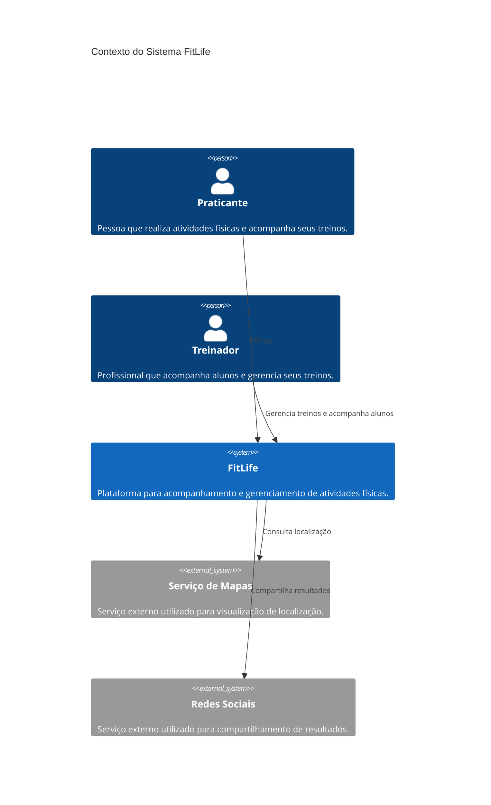
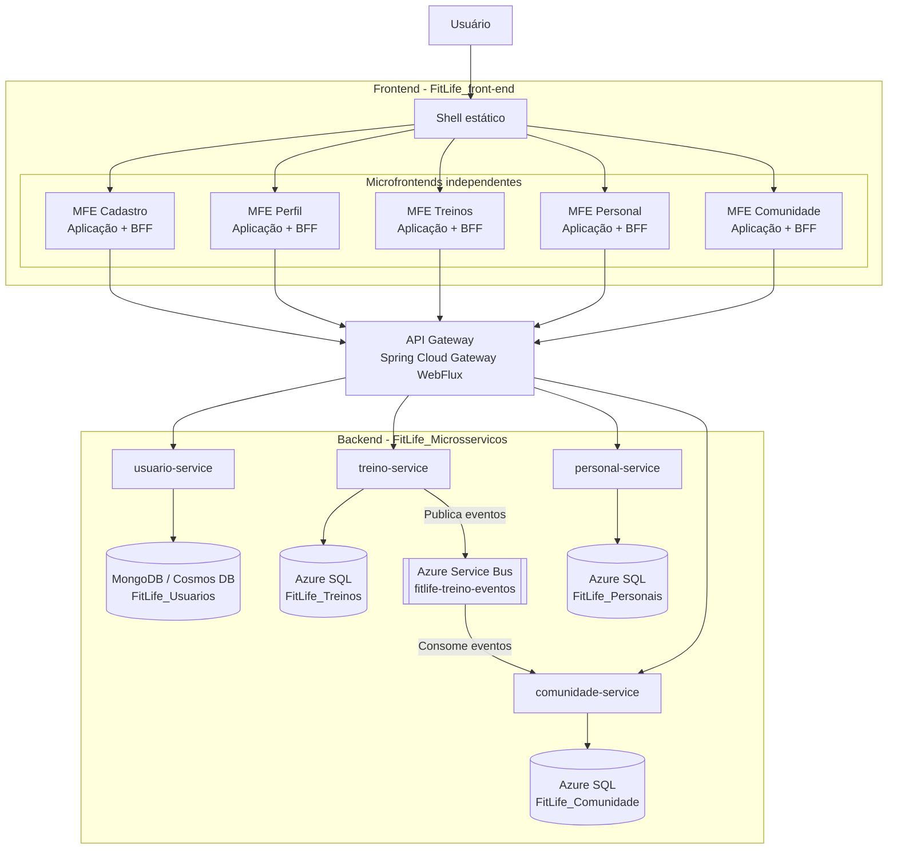
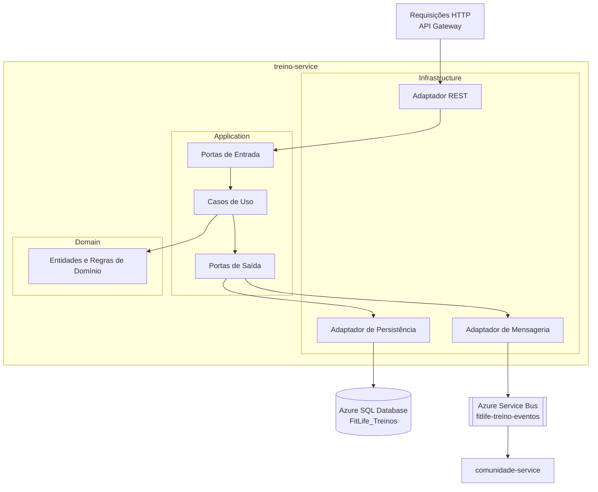
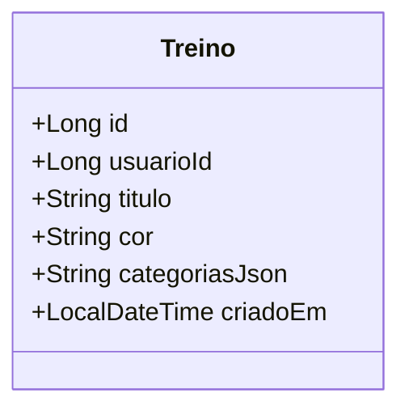
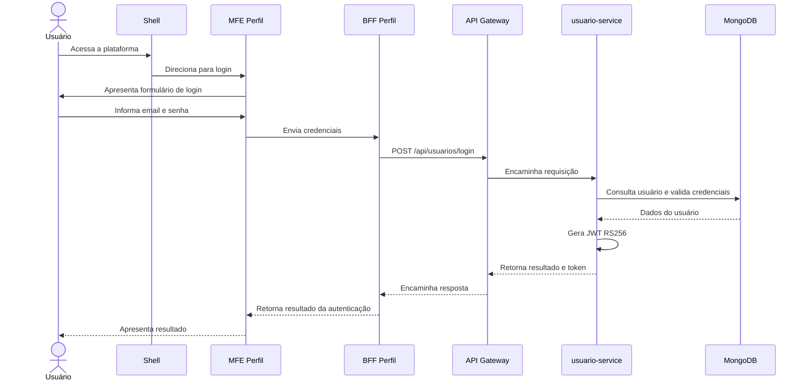
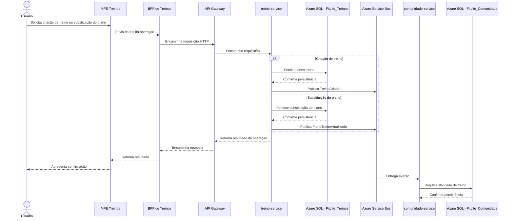
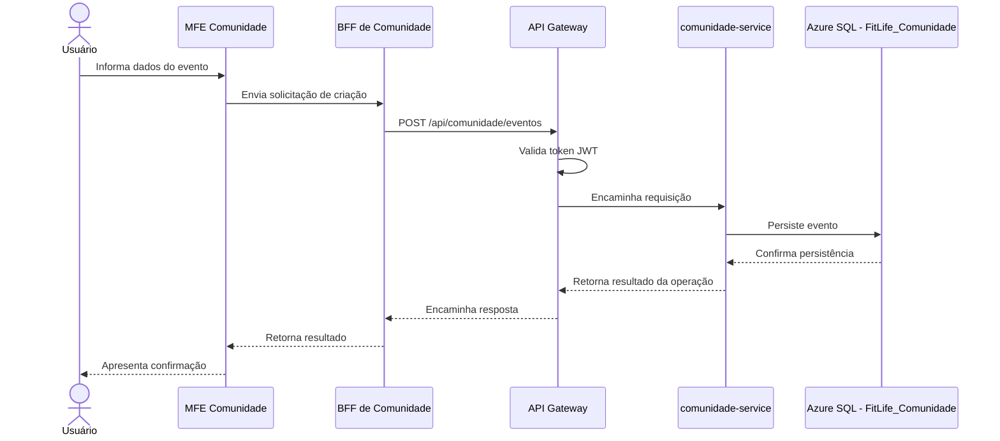
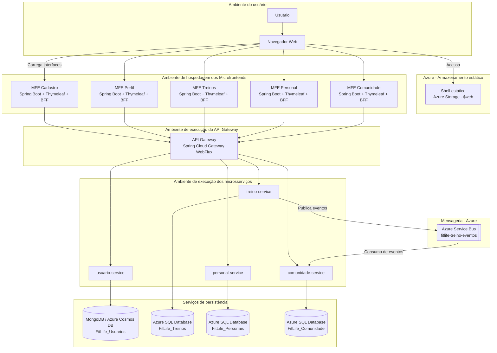

# Arquitetura do Sistema FitLife

## Integrantes

- Amanda Milleo
- Camila Araújo
- Pedro Henrique Kleim Vieira
- Riccardo Randazzo
- Yuri Sobezak

## 1. Introdução e Metas

O FitLife é uma plataforma voltada à promoção de saúde e bem-estar, permitindo que usuários e personal trainers interajam por meio de funcionalidades relacionadas à prática de atividades físicas. O sistema oferece recursos para cadastro e autenticação, gerenciamento de perfis, criação e consulta de planos de treino, acompanhamento de indicadores físicos, busca por profissionais e participação em eventos da comunidade.

A solução adota uma arquitetura distribuída, composta por quatro microsserviços independentes, um API Gateway e um conjunto de Microfrontends organizados em um repositório próprio. Os microsserviços utilizam Arquitetura Hexagonal e possuem mecanismos de persistência independentes, enquanto o acesso às funcionalidades é realizado por meio do API Gateway e dos respectivos BFFs dos Microfrontends.

O objetivo principal é oferecer uma plataforma organizada, acessível e escalável, que facilite o acompanhamento das atividades físicas e a interação entre praticantes e profissionais.

### 1.1. Requisitos e objetivos principais

O sistema deve atender a diferentes tipos de usuários, oferecendo funcionalidades específicas para praticantes e personal trainers. Entre seus principais requisitos estão:

- Permitir o cadastro, a autenticação e o gerenciamento de usuários.
- Possibilitar a criação, consulta e organização de planos de treino personalizados.
- Permitir a interação entre praticantes e personal trainers, facilitando a busca por profissionais.
- Disponibilizar funcionalidades de acompanhamento de indicadores físicos.
- Permitir a criação e participação em eventos relacionados à comunidade.
- Possibilitar a consulta e o compartilhamento de atividades entre usuários.

### 1.2 Metas de Qualidade

A arquitetura também deve considerar como metas de qualidade:

- Segurança: proteger as informações dos usuários, garantindo autenticação, autorização e tratamento adequado dos dados pessoais.
- Usabilidade: oferecer uma interface intuitiva e acessível para usuários de diferentes faixas etárias.
- Desempenho: garantir respostas adequadas durante a utilização das principais funcionalidades.
- Disponibilidade: manter os serviços acessíveis e permitir a evolução independente de seus componentes.
- Manutenibilidade: facilitar a manutenção e evolução do sistema por meio da separação de responsabilidades e da Arquitetura Hexagonal.
- Escalabilidade: permitir o crescimento da plataforma por meio da evolução e do dimensionamento independente dos microsserviços.
- Interoperabilidade: possibilitar a comunicação entre os componentes da solução por meio de interfaces bem definidas e mecanismos de comunicação síncrona e assíncrona.

### 1.3 Stakeholders

Os principais Stakeholders são os usuários, treinadores, administradores da plataforma, patrocinadores, cliente, responsáveis pelo negócio e equipe de desenvolvimento, cujas expectativas envolvem, respectivamente, facilidade de uso e acompanhamento das atividades, oferta e gerenciamento de serviços, controle da plataforma, alcance dos objetivos do produto e uma arquitetura que permita manutenção e evolução do sistema.

## 2. Restrições de arquitetura

Para esta solução serão impostas, para a arquitetura do sistema, as
seguintes características:

- Plataforma SaaS: O cliente exigiu que o sistema fosse no modelo SaaS.
- Integração com serviços externos: funcionalidades como mapa e compartilhamento em redes sociais podem exigir comunicação com APIs externas. O cliente exigiu que o sistema tivesse integração com mapa e compartilhamento de redes sociais.
- Controle de acesso:  Com base na exigência do cliente, foi exigido que no sistema existam diversos tipos de usuário, para que possam existir difereste tipos disponiveis para os diferentes usuario.
- Proteção de dados pessoais: a arquitetura deve considerar os requisitos legais relacionados ao tratamento dos dados dos usuários, especialmente LGPD. Essa escolha foi feita para que o sistema possa estar de acordo com os regulamentos da lei brasileira.

## 3. Contexto e Escopo

Este sistema é destinado a pessoas que praticam atividades físicas e desejam acompanhar seu desenvolvimento. A plataforma permite visualizar e gerenciar atividades e treinos, incluindo informações como exercícios, quantidade de séries e repetições, além de fornecer estimativas de gastos calóricos com base em informações como peso, sexo, idade e biotipo.

O sistema também permite que treinadores acompanhem seus alunos e gerenciem seus respectivos treinos. Além disso, a plataforma possibilita o agendamento e gerenciamento de eventos relacionados às atividades físicas, como corridas e atividades em parques.

### 3.1 Contexto de negócio

Praticante: utiliza o sistema para criar e visualizar seus exercícios diários, definindo exercícios, número de repetições e séries. Também pode acompanhar seu IMC, interagir e contratar treinadores e criar ou participar de eventos relacionados às atividades físicas.

Treinador: utiliza o sistema para acompanhar seus alunos, podendo consultar informações como IMC e objetivos, interagir com os alunos, criar e atualizar treinos e divulgar seus serviços.

O diagrama a seguir representa os principais atores que interagem com o FitLife e os serviços externos utilizados pela plataforma.

### 3.2 Contexto técnico

No FitLife, os usuários, Praticante e Treinador, interagem com a plataforma por meio de uma interface web. O acesso ocorre pelo Shell e pelos Microfrontends, que disponibilizam as funcionalidades do sistema e possuem seus próprios BFFs para intermediar as requisições.

As requisições são encaminhadas ao API Gateway, responsável pelo roteamento para os microsserviços correspondentes, validação dos tokens JWT, controle de CORS e tratamento transversal das requisições.

O Backend é composto por quatro microsserviços independentes: `usuario-service`, `treino-service`, `personal-service` e `comunidade-service`. Cada serviço possui seu próprio banco de dados, seguindo o princípio Database per Service. A comunicação assíncrona entre os serviços ocorre por meio do Azure Service Bus, permitindo a troca de eventos sem a necessidade de acesso direto aos bancos de dados de outros microsserviços.

```mermaid


C4Container
    title Contexto Técnico - FitLife

    Person(praticante, "Praticante", "Utiliza as funcionalidades da plataforma.")
    Person(treinador, "Treinador", "Acompanha alunos e gerencia treinos.")

    System_Boundary(fitlife, "FitLife") {

        Container(shell, "Shell", "HTML, CSS e JavaScript / Azure Storage", "Interface estática que organiza e disponibiliza os Microfrontends.")

        Container_Boundary(frontend, "Repositório Frontend") {
            Container(mfe_cadastro, "MFE Cadastro", "Spring Boot + Thymeleaf + BFF", "Cadastro de usuários.")
            Container(mfe_perfil, "MFE Perfil", "Spring Boot + Thymeleaf + BFF", "Gerenciamento do perfil.")
            Container(mfe_treinos, "MFE Treinos", "Spring Boot + Thymeleaf + BFF", "Consulta e gerenciamento de treinos.")
            Container(mfe_personal, "MFE Personal", "Spring Boot + Thymeleaf + BFF", "Busca e contato com personal trainers.")
            Container(mfe_comunidade, "MFE Comunidade", "Spring Boot + Thymeleaf + BFF", "Eventos e atividades da comunidade.")
        }

        Container(gateway, "API Gateway", "Spring Cloud Gateway WebFlux", "Roteamento, CORS, validação JWT via JWKS e tratamento transversal das requisições.")

        Container_Boundary(backend, "Repositório Backend") {
            Container(usuario, "usuario-service", "Java 21 + Spring Boot", "Cadastro, autenticação e gerenciamento de usuários.")
            Container(treino, "treino-service", "Java 21 + Spring Boot", "Gerenciamento de treinos e planos.")
            Container(personal, "personal-service", "Java 21 + Spring Boot", "Busca de profissionais e registro de contatos.")
            Container(comunidade, "comunidade-service", "Java 21 + Spring Boot", "Eventos, participações e atividades.")
        }

        ContainerDb(db_usuario, "Banco de Usuários", "MongoDB / Cosmos DB API for MongoDB", "Dados dos usuários.")
        ContainerDb(db_treino, "Banco de Treinos", "Azure SQL Database", "Dados dos treinos.")
        ContainerDb(db_personal, "Banco de Personais", "Azure SQL Database", "Dados dos profissionais.")
        ContainerDb(db_comunidade, "Banco da Comunidade", "Azure SQL Database", "Eventos, participações e atividades.")

        ContainerQueue(bus, "Azure Service Bus", "Fila fitlife-treino-eventos", "Transporte assíncrono de eventos de treino.")
    }

    System_Ext(mapa, "Serviço de Mapas", "Serviço externo de localização.")
    System_Ext(redes, "Redes Sociais", "Serviços externos de compartilhamento.")

    Rel(praticante, shell, "Acessa")
    Rel(treinador, shell, "Acessa")

    Rel(shell, mfe_cadastro, "Disponibiliza")
    Rel(shell, mfe_perfil, "Disponibiliza")
    Rel(shell, mfe_treinos, "Disponibiliza")
    Rel(shell, mfe_personal, "Disponibiliza")
    Rel(shell, mfe_comunidade, "Disponibiliza")

    Rel(mfe_cadastro, gateway, "Envia requisições pelo BFF", "HTTPS")
    Rel(mfe_perfil, gateway, "Envia requisições pelo BFF", "HTTPS")
    Rel(mfe_treinos, gateway, "Envia requisições pelo BFF", "HTTPS")
    Rel(mfe_personal, gateway, "Envia requisições pelo BFF", "HTTPS")
    Rel(mfe_comunidade, gateway, "Envia requisições pelo BFF", "HTTPS")

    Rel(gateway, usuario, "Roteia /api/usuarios/", "HTTP")
    Rel(gateway, treino, "Roteia /api/treinos/", "HTTP")
    Rel(gateway, personal, "Roteia /api/personais/", "HTTP")
    Rel(gateway, comunidade, "Roteia /api/comunidade/", "HTTP")
    Rel(gateway, usuario, "Obtém JWKS em /oauth2/jwks", "HTTP")

    Rel(usuario, db_usuario, "Lê e grava dados")
    Rel(treino, db_treino, "Lê e grava dados")
    Rel(personal, db_personal, "Lê e grava dados")
    Rel(comunidade, db_comunidade, "Lê e grava dados")

    Rel(treino, bus, "Publica eventos", "Azure Service Bus")
    Rel(bus, comunidade, "Entrega eventos", "Azure Service Bus")

    Rel(comunidade, mapa, "Integração externa, quando aplicável", "HTTPS")
    Rel(comunidade, redes, "Integração externa, quando aplicável", "HTTPS")

```

## 4. Estratégia da Solução

O sistema será desenvolvido utilizando as linguagens Java, JavaScript, HTML, CSS e SQL. Para o desenvolvimento do backend e dos BFFs dos Microfrontends, será utilizado o framework Spring Boot, enquanto o API Gateway será desenvolvido com Spring Cloud Gateway WebFlux. O frontend adotará uma arquitetura de Microfrontends, composta por um Shell estático e cinco aplicações independentes: cadastro, perfil, treinos, personal e comunidade. Cada Microfrontend possui sua própria aplicação Spring Boot, camada web com Thymeleaf, arquivos estáticos e BFF, responsável por intermediar as requisições entre sua interface e o backend.

O backend será organizado em quatro microsserviços independentes: `usuario-service`, `treino-service`, `personal-service` e `comunidade-service`. Cada microsserviço adotará a Arquitetura Hexagonal (Ports and Adapters), com separação das responsabilidades nas camadas de domínio, aplicação e infraestrutura. Essa organização permite isolar as regras de negócio dos detalhes técnicos de comunicação e persistência, utilizando adaptadores para receber requisições REST, acessar os bancos de dados e integrar serviços externos.

A persistência seguirá o padrão Database per Service, no qual cada microsserviço possui seu próprio banco de dados. O `usuario-service` utilizará MongoDB ou Azure Cosmos DB for MongoDB, enquanto os serviços de treinos, personal e comunidade utilizarão databases independentes no Azure SQL Database. A comunicação entre os componentes ocorrerá por meio de requisições HTTP encaminhadas pelo API Gateway. Para a comunicação assíncrona, será utilizado o Azure Service Bus: o `treino-service` publica eventos relacionados à criação de treinos e à atualização de planos, enquanto o `comunidade-service` os consome para registrar as atividades correspondentes.

O sistema também contará com diferentes níveis de acesso, utilizando autenticação baseada em JWT com assinatura RS256. O `usuario-service` é responsável pela autenticação e emissão dos tokens, disponibilizando a chave pública por meio de JWKS. O API Gateway realiza a validação dos tokens nas requisições protegidas, além de centralizar o roteamento das APIs, o controle de CORS e o tratamento transversal das requisições. O desenvolvimento também considera os requisitos da LGPD para garantir a proteção dos dados pessoais.

As escolhas arquiteturais foram realizadas visando principalmente à manutenibilidade, organização e possibilidade de evolução do sistema. A Arquitetura Hexagonal permite separar as regras de negócio dos mecanismos de infraestrutura, facilitando alterações nos recursos técnicos sem comprometer o domínio. A divisão em microsserviços possibilita que cada parte do sistema seja desenvolvida, testada e evoluída de maneira independente, enquanto a arquitetura de Microfrontends permite organizar as interfaces em aplicações separadas. A utilização do Java em conjunto com o Spring Boot fornece uma estrutura consolidada para o desenvolvimento das aplicações, enquanto o padrão Database per Service mantém a independência dos dados de cada microsserviço. Por fim, o API Gateway e o Azure Service Bus organizam, respectivamente, a comunicação síncrona e assíncrona entre os componentes do sistema.

## 5.Visão do Sistema em Blocos de Construção

### 5.1 Sistema Total em Caixa Branca

O FitLife é composto por diferentes componentes responsáveis por oferecer as funcionalidades da plataforma. Sua estrutura é organizada em uma arquitetura distribuída, formada por um frontend baseado em Microfrontends, um API Gateway e quatro microsserviços independentes no backend.

O frontend é composto por um Shell estático, responsável pela navegação inicial e pelo direcionamento dos usuários, e cinco Microfrontends independentes: Cadastro, Perfil, Treinos, Personal e Comunidade. Cada Microfrontend possui sua própria aplicação Spring Boot, com camada web e um Backend for Frontend (BFF), responsável por intermediar as requisições realizadas pela interface.

As requisições dos BFFs são encaminhadas ao API Gateway, responsável pelo roteamento para os microsserviços correspondentes, validação dos tokens JWT, controle de CORS e tratamento transversal das requisições.

O backend é dividido em quatro microsserviços:

- Gestão de Usuários (`usuario-service`): responsável pelo cadastro, autenticação, consulta e atualização dos dados dos usuários, incluindo informações médicas e fotos de perfil.
- Gestão de Treinos (`treino-service`): responsável pela criação, consulta, atualização e exclusão de treinos, além da substituição dos planos de treino dos usuários.
- Gestão de Treinadores (`personal-service`): responsável pela busca de personais por modalidade e cidade e pelo registro de interesses e contatos.
- Gestão de Comunidade e Eventos (`comunidade-service`): responsável pela criação e atualização de eventos, participação dos usuários e consulta de atividades recebidas por mensageria.

Cada microsserviço possui sua própria persistência, seguindo o padrão Database per Service. O `usuario-service` utiliza MongoDB ou Azure Cosmos DB for MongoDB, enquanto os demais utilizam databases independentes no Azure SQL Database. Dessa forma, cada serviço mantém a responsabilidade pelos próprios dados, sem consultas diretas ou chaves estrangeiras entre os bancos.

Além da comunicação síncrona por HTTP, o sistema utiliza o Azure Service Bus para comunicação assíncrona entre o `treino-service` e o `comunidade-service`. Quando um treino é criado ou um plano é atualizado, o serviço de treinos publica um evento que é consumido pelo serviço de comunidade, permitindo o registro da atividade correspondente.

A tabela a seguir apresenta os principais blocos funcionais e suas respectivas responsabilidades.

| Bloco | Responsabilidade |
|---|---|
| Shell | Disponibilizar a navegação inicial e direcionar o usuário aos Microfrontends. |
| Microfrontends e BFFs | Apresentar as interfaces e intermediar as requisições ao backend por meio do API Gateway. |
| API Gateway | Centralizar o roteamento das APIs, validação JWT, CORS e tratamento transversal das requisições. |
| Gestão de Usuários | Gerenciar cadastro, autenticação e informações dos usuários. |
| Gestão de Treinos | Gerenciar treinos e planos de treino dos usuários. |
| Gestão de Treinadores | Disponibilizar a busca e o contato com treinadores. |
| Gestão de Comunidade e Eventos | Gerenciar eventos, participações e atividades da comunidade. |
| Persistência de Dados | Armazenar os dados em bancos independentes, pertencentes a cada microsserviço. |
| Mensageria | Permitir a comunicação assíncrona entre os serviços de treinos e comunidade. |

Os componentes se comunicam por meio de interfaces bem definidas. As requisições síncronas são encaminhadas pelo API Gateway, enquanto a comunicação assíncrona utiliza eventos publicados no Azure Service Bus. A persistência é realizada individualmente por cada microsserviço, respeitando a separação dos dados e das responsabilidades.

### 5.2 Nível 2

O `treino-service` é responsável pelo gerenciamento dos treinos dos usuários, concentrando as operações de criação, consulta, atualização e exclusão de treinos, além da substituição dos planos de treino.

O microsserviço utiliza a Arquitetura Hexagonal (Ports and Adapters), organizando suas responsabilidades em três camadas principais:

- Domínio (`domain`): concentra as entidades e regras de negócio relacionadas aos treinos, mantendo independência dos mecanismos de infraestrutura.
- Aplicação (`application`): coordena os casos de uso do microsserviço, recebendo as solicitações por meio das portas de entrada e utilizando as portas de saída quando precisa acessar recursos externos.
- Infraestrutura (`infrastructure`): contém os adaptadores responsáveis pela comunicação com o exterior, incluindo o recebimento de requisições REST, a persistência dos dados no Azure SQL Database e a publicação de eventos no Azure Service Bus.

As requisições são recebidas pelo adaptador REST, que encaminha as operações à camada de aplicação. Quando necessário, a aplicação utiliza as portas de saída para acessar o banco de dados por meio do adaptador de persistência. Dessa forma, as regras de negócio permanecem isoladas dos detalhes de implementação do banco de dados e dos mecanismos de comunicação.

Além disso, quando um treino é criado ou um plano de treino é atualizado, o microsserviço publica os eventos correspondentes no Azure Service Bus. Esses eventos são posteriormente consumidos pelo `comunidade-service`, permitindo o registro das atividades relacionadas aos treinos.

A estrutura pode ser representada pelos seguintes componentes e responsabilidades:

| Componente | Responsabilidade |
|---|---|
| Adaptador REST | Receber as requisições HTTP e encaminhá-las para os casos de uso da aplicação. |
| Portas de entrada | Definir as operações disponibilizadas pela camada de aplicação. |
| Camada de aplicação | Coordenar os casos de uso e a execução das operações de gerenciamento de treinos. |
| Camada de domínio | Concentrar as entidades e regras de negócio relacionadas aos treinos. |
| Portas de saída | Definir os contratos necessários para acesso aos recursos externos. |
| Adaptador de persistência | Implementar o acesso aos dados armazenados no Azure SQL Database. |
| Adaptador de mensageria | Publicar eventos no Azure Service Bus após as operações correspondentes. |

Essa organização permite que o `treino-service` mantenha suas regras de negócio independentes dos mecanismos de persistência e comunicação, facilitando a manutenção, os testes e a evolução do microsserviço.

### 5.3 Nível 3

O `treino-service` é um dos componentes centrais do sistema, sendo responsável pelo gerenciamento dos treinos dos usuários. Ele disponibiliza operações para criação, consulta, atualização e exclusão de treinos, além de permitir a substituição do plano de treino de um usuário.

Internamente, o microsserviço segue a Arquitetura Hexagonal, organizando suas responsabilidades em três camadas principais:

- Domínio: concentra a representação e as regras relacionadas aos treinos. A entidade principal é `Treino`, que possui identificador, referência ao usuário, título, cor, categorias e data de criação.
- Aplicação: coordena os casos de uso do microsserviço, realizando a comunicação entre o domínio e as operações disponibilizadas pelas portas.
- Infraestrutura: contém os adaptadores responsáveis pela comunicação com o exterior, incluindo os endpoints REST, a persistência no Azure SQL Database e a publicação de eventos no Azure Service Bus.

As requisições externas são recebidas pelo adaptador REST e encaminhadas à camada de aplicação. Quando uma operação exige persistência, a aplicação utiliza as portas de saída para acessar os dados por meio do adaptador de persistência. Após a criação de um treino ou a substituição de um plano, o microsserviço também publica os eventos correspondentes no Azure Service Bus, permitindo que o `comunidade-service` registre essas atividades.

O diagrama a seguir representa a estrutura conceitual do domínio do `treino-service`, destacando a entidade principal e seus atributos, conforme a estrutura de persistência implementada.

A entidade `Treino` representa a estrutura principal do domínio e mantém a associação com exercícios e séries. A entidade `Exercicio` representa as atividades disponíveis para composição dos treinos. A entidade `Serie` representa a execução planejada de um exercício. O tipo `TipoTreino` define as categorias suportadas pelo sistema. A interface `TreinoRule` define contratos para regras de negócio especializadas e o componente `ValidadorTreino` centraliza as validações necessárias antes da persistência dos dados.

## 6. Visão de Execução

### 6.1 Autenticação

Durante a autenticação, o usuário acessa a interface de login disponibilizada pelo frontend. O Shell direciona o usuário ao Microfrontend de Perfil, responsável pelo login e pela comunicação com seu Backend for Frontend (BFF).

Ao informar suas credenciais, a interface encaminha a requisição ao BFF do MFE Perfil, que realiza uma chamada HTTP ao API Gateway. O Gateway identifica a rota `/api/usuarios/login` e encaminha a requisição ao `usuario-service`, responsável por validar as credenciais utilizando os dados armazenados no MongoDB.

Caso as credenciais sejam válidas, o `usuario-service` gera um token JWT assinado com RS256 e retorna o resultado da autenticação. A resposta percorre o caminho inverso, passando pelo API Gateway e pelo BFF do MFE Perfil até chegar à interface, que disponibiliza o resultado ao usuário.

Nas requisições posteriores que exigem autenticação, o token JWT é encaminhado ao API Gateway, que realiza sua validação utilizando a chave pública disponibilizada pelo `usuario-service` por meio do endpoint JWKS. Requisições com tokens inválidos ou expirados são rejeitadas, enquanto as válidas podem ser encaminhadas ao microsserviço correspondente.

### 6.2 Criação de treino e atualização de plano

Durante a criação de um treino, o usuário informa os dados necessários por meio da interface web. A requisição é encaminhada ao BFF do Microfrontend de Treinos, que a direciona ao API Gateway. O Gateway encaminha a solicitação ao `treino-service`, responsável por processar a operação e armazenar os dados no Azure SQL Database.

Após a persistência, o `treino-service` publica um evento no Azure Service Bus, informando a criação do treino. O `comunidade-service` consome esse evento e registra a atividade correspondente em sua própria base de dados, permitindo que ela seja consultada posteriormente na comunidade.

O mesmo fluxo de comunicação assíncrona ocorre quando o plano de treino de um usuário é substituído. Nesse caso, o `treino-service` publica o evento `PlanoTreinoAtualizado`, que também é consumido pelo `comunidade-service`.

Ao final da operação, a resposta da requisição é encaminhada pelo API Gateway e pelo BFF até a interface, que apresenta ao usuário o resultado da solicitação.

### 6.3 Criação de evento

Durante a criação de um evento, o usuário informa os dados necessários por meio da interface web do Microfrontend de Comunidade. A requisição é encaminhada ao BFF correspondente, que a direciona ao API Gateway. O Gateway valida o token JWT e encaminha a solicitação ao `comunidade-service`, responsável pelo gerenciamento dos eventos.

O serviço processa a solicitação e realiza o armazenamento das informações no Azure SQL Database, em sua própria base de dados. Após a confirmação da persistência, o resultado da operação é retornado pelo API Gateway e pelo BFF até a interface, que apresenta ao usuário a confirmação da criação do evento.

Dessa forma, o gerenciamento dos eventos permanece sob responsabilidade do `comunidade-service`, sem dependência de acesso direto ao banco de dados por outros microsserviços.

## 7. Visão de Implantação

O FitLife será disponibilizado por meio de uma infraestrutura distribuída, na qual seus componentes são implantados e executados de maneira independente. Diferentemente de uma aplicação monolítica hospedada em um único servidor físico, o sistema é composto por um frontend baseado em Microfrontends, um API Gateway e quatro microsserviços responsáveis pelas funcionalidades do backend.

O Shell do frontend é uma aplicação estática publicada no Azure Storage, utilizando o contêiner `$web`. Os cinco Microfrontends são aplicações Spring Boot independentes, cada uma contendo sua própria interface web, desenvolvida com Thymeleaf, arquivos estáticos e BFF. Cada aplicação pode ser compilada, executada e publicada individualmente.

As requisições realizadas pelos Microfrontends são encaminhadas ao API Gateway, desenvolvido com Spring Cloud Gateway WebFlux. Esse componente centraliza o acesso às APIs, realiza o roteamento das requisições, valida os tokens JWT e aplica as configurações de CORS.

O backend é composto pelos microsserviços `usuario-service`, `treino-service`, `personal-service` e `comunidade-service`, desenvolvidos com Java 21 e Spring Boot. Cada serviço possui sua própria persistência: o `usuario-service` utiliza MongoDB ou Azure Cosmos DB for MongoDB, enquanto os demais utilizam databases independentes no Azure SQL Database.

Além disso, o sistema utiliza o Azure Service Bus para permitir a comunicação assíncrona entre o `treino-service` e o `comunidade-service`. O primeiro publica eventos relacionados à criação de treinos e à atualização de planos, enquanto o segundo consome essas mensagens e registra as atividades em sua própria base de dados.

Os usuários acessam o sistema por meio de navegadores web, sem necessidade de instalação de aplicações locais. A infraestrutura distribuída permite que os componentes sejam implantados e evoluídos de forma independente, respeitando as responsabilidades de cada parte do sistema.

A localização específica dos ambientes de hospedagem dos Microfrontends, do API Gateway e dos microsserviços deve ser definida conforme a configuração de implantação utilizada. Portanto, a representação a seguir destaca os componentes e recursos de infraestrutura conhecidos, sem pressupor uma plataforma de hospedagem não confirmada.

## 8. Conceitos Transversais

1. Autenticação e Autorização: O sistema precisa identificar os usuários e controlar o acesso às funcionalidades conforme suas permissões. A autenticação é realizada pelo `usuario-service`, responsável por validar as credenciais e emitir tokens JWT com assinatura RS256. A validação dos tokens nas requisições protegidas é realizada pelo API Gateway, utilizando a chave pública disponibilizada pelo serviço de usuários por meio do endpoint JWKS. Dessa forma, o controle de acesso é integrado à comunicação entre os componentes, sem depender diretamente dos mecanismos utilizados pelas interfaces.

2. Persistência de Dados: Os diferentes microsserviços precisam armazenar e consultar informações de forma independente. O sistema utiliza o padrão Database per Service, no qual o `usuario-service` utiliza MongoDB ou Azure Cosmos DB for MongoDB, enquanto os serviços `treino-service`, `personal-service` e `comunidade-service` utilizam databases independentes no Azure SQL Database. O acesso aos dados é realizado por meio de adaptadores de persistência que implementam as portas definidas pela aplicação, seguindo a Arquitetura Hexagonal. Dessa forma, as regras de negócio não dependem diretamente das tecnologias utilizadas para armazenar os dados.

3. Proteção de Dados: O sistema deverá considerar os requisitos aplicáveis da Lei Geral de Proteção de Dados (LGPD) no tratamento das informações dos usuários, especialmente em relação ao armazenamento, à alteração, à consulta e à exclusão de dados pessoais. O acesso às informações deverá respeitar as permissões aplicáveis a cada operação, evitando utilização ou exposição indevida. A separação dos dados entre os microsserviços também permite que cada serviço mantenha a responsabilidade pelas informações sob seu domínio.

4. Integração entre Componentes e Serviços Externos: A comunicação entre os componentes internos do sistema ocorre por meio de requisições HTTP encaminhadas pelo API Gateway, enquanto os Microfrontends utilizam seus próprios BFFs para intermediar as solicitações realizadas pelas interfaces. Para a comunicação assíncrona entre microsserviços, o sistema utiliza o Azure Service Bus. O `treino-service` publica eventos relacionados à criação de treinos e à atualização de planos, que são consumidos pelo `comunidade-service` para registrar as atividades correspondentes. As integrações com serviços externos, como mapas, localização e redes sociais, deverão utilizar adaptadores específicos caso sejam implementadas, evitando o acoplamento direto das regras de negócio com essas tecnologias.

5. Tratamento de Erros: O sistema deverá tratar erros durante suas operações, incluindo falhas de validação, problemas de persistência e indisponibilidade de componentes ou serviços externos. Nas requisições HTTP, os erros deverão ser tratados de forma adequada pelos componentes responsáveis, sem expor informações internas ou sensíveis aos usuários. Na comunicação assíncrona, o `comunidade-service` utiliza o campo `eventId` para garantir a idempotência do processamento das mensagens, evitando registros duplicados quando um mesmo evento é recebido mais de uma vez. Além disso, a independência entre os microsserviços permite que falhas em um componente não impliquem necessariamente a interrupção dos demais.

## 9. Decisões de Arquitetura

### 9.1 Arquitetura de Microsserviços e Arquitetura Hexagonal

| Campo | Descrição |
|---|---|
| Título | Arquitetura de Microsserviços e Arquitetura Hexagonal |
| Contexto | O sistema precisa organizar suas funcionalidades de maneira independente, permitindo que diferentes partes sejam desenvolvidas, testadas e evoluídas sem depender de uma única aplicação centralizada. |
| Decisão | Adotar uma arquitetura baseada em quatro microsserviços independentes (`usuario-service`, `treino-service`, `personal-service` e `comunidade-service`), utilizando Arquitetura Hexagonal (Ports and Adapters) para organizar internamente cada serviço nas camadas de domínio, aplicação e infraestrutura. |
| Estado | Aceita |
| Consequência | A separação das responsabilidades facilita a manutenção, os testes e a evolução independente dos serviços. Entretanto, aumenta a complexidade da comunicação e da integração entre os componentes distribuídos. |

### 9.2 Arquitetura de Microfrontends

| Campo | Descrição |
|---|---|
| Título | Arquitetura de Microfrontends |
| Contexto | O frontend precisa organizar suas funcionalidades em aplicações independentes, permitindo que diferentes partes da interface sejam desenvolvidas e mantidas separadamente. |
| Decisão | Adotar uma arquitetura de Microfrontends composta por um Shell estático e cinco aplicações independentes: Cadastro, Perfil, Treinos, Personal e Comunidade. Cada Microfrontend possui sua própria aplicação Spring Boot, camada web com Thymeleaf e BFF. |
| Estado | Aceita |
| Consequência | A divisão permite desenvolver e publicar cada Microfrontend individualmente, facilitando sua manutenção e evolução. Entretanto, exige organização da comunicação e integração entre as diferentes aplicações. |

### 9.3 Utilização do Spring

| Campo | Descrição |
|---|---|
| Título | Utilização do Spring |
| Contexto | O sistema necessita de uma estrutura consolidada para desenvolver os serviços de backend, os BFFs e o componente responsável pelo roteamento das requisições. |
| Decisão | Utilizar Java 21 e Spring Boot no desenvolvimento dos microsserviços e das aplicações dos Microfrontends. Para o API Gateway, utilizar Spring Cloud Gateway WebFlux. |
| Estado | Aceita |
| Consequência | A utilização do ecossistema Spring fornece recursos para desenvolvimento, configuração e integração dos componentes, mantendo uma base tecnológica comum entre as aplicações. |

### 9.4 Persistência de Dados

| Campo | Descrição |
|---|---|
| Título | Persistência de Dados |
| Contexto | O sistema precisa armazenar e consultar informações de maneira organizada, garantindo a independência dos dados pertencentes a cada microsserviço. |
| Decisão | Adotar o padrão Database per Service, utilizando MongoDB ou Azure Cosmos DB for MongoDB no `usuario-service` e databases independentes no Azure SQL Database para os serviços `treino-service`, `personal-service` e `comunidade-service`. O acesso aos dados será realizado por adaptadores de persistência, seguindo a Arquitetura Hexagonal. |
| Estado | Aceita |
| Consequência | Cada microsserviço mantém o controle sobre seus próprios dados, reduzindo o acoplamento entre os serviços. Entretanto, consultas que envolvem informações de diferentes serviços precisam considerar mecanismos de comunicação entre eles, sem acesso direto aos respectivos bancos. |

### 9.5 Autenticação e Segurança

| Campo | Descrição |
|---|---|
| Título | Autenticação e Segurança |
| Contexto | O sistema precisa identificar os usuários e proteger o acesso às operações disponibilizadas pelos microsserviços, evitando requisições não autenticadas aos recursos protegidos. |
| Decisão | Utilizar autenticação baseada em tokens JWT com assinatura RS256. O `usuario-service` será responsável pela validação das credenciais e emissão dos tokens, disponibilizando a chave pública por meio do endpoint JWKS. O API Gateway realizará a validação dos tokens nas requisições protegidas. |
| Estado | Aceita |
| Consequência | A utilização de tokens JWT permite validar a autenticidade das requisições sem exigir que os usuários enviem suas credenciais a cada operação. A centralização da validação no Gateway também padroniza o acesso às APIs protegidas. |

### 9.6 Comunicação entre Microsserviços

| Campo | Descrição |
|---|---|
| Título | Comunicação entre Microsserviços |
| Contexto | A arquitetura distribuída exige mecanismos de comunicação entre os serviços, permitindo que suas funcionalidades sejam integradas sem comprometer a independência de cada componente. |
| Decisão | Utilizar requisições HTTP para a comunicação síncrona entre os componentes e Azure Service Bus para comunicação assíncrona entre o `treino-service` e o `comunidade-service`. O serviço de treinos publicará os eventos `TreinoCriado` e `PlanoTreinoAtualizado`, que serão consumidos pelo serviço de comunidade. |
| Estado | Aceita |
| Consequência | A comunicação síncrona permite obter respostas imediatas das operações, enquanto a mensageria reduz a dependência temporal entre os serviços. Entretanto, a comunicação assíncrona exige tratamento de duplicidade e consistência eventual entre os dados dos microsserviços. |

## 10. Requisitos de Qualidade

Os requisitos de qualidade do FitLife definem as características não funcionais que devem ser atendidas pela arquitetura do sistema, garantindo que a plataforma não apenas ofereça as funcionalidades previstas, mas também seja segura, eficiente, acessível, confiável e preparada para evoluir.

Considerando o público-alvo, as funcionalidades e as restrições arquiteturais apresentadas anteriormente, os principais requisitos de qualidade definidos para o sistema abrangem as áreas de segurança, usabilidade, desempenho, disponibilidade, manutenibilidade, escalabilidade, privacidade e interoperabilidade.

Esses requisitos influenciam diretamente as decisões arquiteturais do projeto. A utilização de uma arquitetura baseada em microsserviços, da Arquitetura Hexagonal, de Microfrontends, do Spring Framework, de mecanismos de controle de acesso e de comunicação entre componentes foi definida para contribuir com o atendimento desses requisitos durante o desenvolvimento e a evolução do FitLife.

### 10.1 Visão Geral dos Requisitos de Qualidade

Para os principais requisitos de qualidade do sistema, foram definidos:

RQ01: O sistema deve proteger as contas, credenciais e dados dos usuários, utilizando autenticação, autorização e controle de acesso de acordo com as permissões de cada usuário.

RQ02: Os dados pessoais devem ser tratados de acordo com os princípios e requisitos aplicáveis da LGPD, evitando acesso ou utilização indevida das informações.

RQ03: A plataforma deve possuir interfaces simples, intuitivas e de fácil compreensão, considerando a faixa etária dos usuários.

RQ04: As principais operações, como login, consulta de treinos, visualização de eventos e atualização de informações, devem apresentar tempos de resposta adequados em suas execuções.

RQ05: O sistema deve permanecer disponível para que praticantes e treinadores possam acessar suas informações e funcionalidades quando necessário.

RQ06: A separação de responsabilidades entre os microsserviços, a Arquitetura Hexagonal e a organização independente dos Microfrontends devem facilitar a correção de problemas, manutenção e implementação de novas funcionalidades.

RQ07: A arquitetura deve permitir que o sistema suporte o crescimento da quantidade de usuários, treinos, eventos e dados armazenados, possibilitando a evolução independente dos componentes conforme a demanda.

RQ08: O sistema deve permitir a comunicação e a troca de informações entre seus componentes por meio de APIs e mecanismos de mensageria, além de possibilitar a integração com serviços externos quando necessário.

### 10.2 Cenários de Qualidade

Para verificar se os requisitos de qualidade são atendidos, foram definidos cenários que representam situações que podem ocorrer durante a utilização do FitLife.

Cenário 1 – Acesso não autorizado a funcionalidade restrita

- Fonte do estímulo: Usuário do sistema.
- Estímulo: Um usuário tenta acessar uma funcionalidade que não está disponível para suas permissões.
- Ambiente: Sistema em funcionamento.
- Artefato: API Gateway, microsserviços e mecanismos de controle de acesso.
- Resposta: O sistema deve verificar a identidade do usuário e suas permissões, impedindo o acesso não autorizado.
- Medida de resposta: Todas as funcionalidades protegidas devem realizar a validação de autenticação e autorização antes de permitir a operação.

Cenário 2 – Consulta de treinos por um praticante

- Fonte do estímulo: Praticante.
- Estímulo: O usuário solicita a visualização de seus treinos.
- Ambiente: Sistema em funcionamento e utilização normal.
- Artefato: MFE Treinos, BFF, API Gateway, `treino-service` e Azure SQL Database.
- Resposta: O sistema deve processar a solicitação e apresentar os treinos ao usuário.
- Medida de resposta: A consulta deve apresentar os resultados em até 3 segundos em condições normais de utilização.

Cenário 3 – Criação de um treino por um novo praticante

- Fonte do estímulo: Novo praticante.
- Estímulo: O usuário deseja criar um novo treino.
- Ambiente: Sistema em funcionamento.
- Artefato: MFE Treinos e seus componentes de comunicação com o backend.
- Resposta: O usuário deve conseguir localizar a funcionalidade e cadastrar o treino sem precisar de conhecimentos técnicos.
- Medida de resposta: As funcionalidades devem apresentar navegação intuitiva, informações claras e mensagens de erro compreensíveis.

Cenário 4 – Acesso ao sistema durante sua operação

- Fonte do estímulo: Praticante ou treinador.
- Estímulo: O usuário acessa o sistema para consultar seus treinos ou informações.
- Ambiente: Sistema em operação.
- Artefato: Shell, Microfrontends, API Gateway e microsserviços.
- Resposta: O sistema deve estar disponível e permitir a utilização das funcionalidades principais.
- Medida de resposta: O sistema deve buscar uma disponibilidade mensal de 99,5% para suas funcionalidades principais.

Cenário 5 – Aumento simultâneo de usuários

- Fonte do estímulo: Crescimento da plataforma.
- Estímulo: O número de usuários acessando o sistema simultaneamente aumenta.
- Ambiente: Sistema sob aumento de carga.
- Artefato: Microfrontends, API Gateway, microsserviços e bancos de dados.
- Resposta: O sistema deve continuar processando as requisições sem apresentar degradação significativa do serviço.
- Medida de resposta: A arquitetura deve permitir a ampliação dos recursos dos componentes e a otimização dos bancos de dados conforme o crescimento da demanda.

Cenário 6 – Solicitação de alteração ou exclusão de dados pessoais

- Fonte do estímulo: Usuário.
- Estímulo: O usuário solicita uma operação relacionada aos seus dados pessoais, como alteração ou exclusão, quando aplicável.
- Ambiente: Sistema em funcionamento.
- Artefato: MFE responsável pela operação, API Gateway, `usuario-service` e banco de dados de usuários.
- Resposta: O sistema deve validar a identidade e as permissões do usuário e realizar a operação de acordo com as regras definidas para o tratamento dos dados.
- Medida de resposta: As operações sobre dados pessoais devem ser protegidas contra acessos não autorizados e seguir as regras de privacidade definidas pelo sistema.

Cenário 7 – Consulta de localização de um evento

- Fonte do estímulo: Praticante.
- Estímulo: O usuário deseja visualizar a localização de um evento no mapa.
- Ambiente: Sistema em funcionamento e serviço externo disponível.
- Artefato: MFE Comunidade e eventual adaptador de integração com a API de mapas.
- Resposta: Caso a integração seja disponibilizada, o sistema deverá consultar o serviço externo e apresentar a localização do evento ao usuário.
- Medida de resposta: A localização deve ser apresentada corretamente; em caso de indisponibilidade da API externa, o sistema deve apresentar uma mensagem informando que o serviço não está disponível.

## 11. Riscos e Dívidas Técnicas

Esta seção apresenta os principais riscos e dívidas técnicas identificados no FitLife, considerando sua arquitetura distribuída, comunicação entre serviços, persistência de dados e infraestrutura. As classificações de probabilidade e impacto são estimativas para o estágio atual do projeto.

| ID | Risco / Dívida Técnica | Probabilidade | Impacto | Mitigação |
|---|---|---|---|---|
| R01 | Acoplamento entre domínio e infraestrutura nos microsserviços. | Baixa | Alto | Manter a separação entre domínio, aplicação e infraestrutura, utilizando portas e adaptadores e testes com ArchUnit. |
| R02 | Falhas de comunicação entre microsserviços. | Média | Alto | Implementar tratamento de erros, timeouts e monitoramento das requisições. |
| R03 | Falhas na publicação ou no processamento de eventos pelo Azure Service Bus. | Média | Alto | Utilizar identificadores para evitar duplicidades e prever mecanismos de reprocessamento. |
| R04 | Inconsistência ou duplicidade de dados entre bancos independentes. | Média | Médio | Respeitar a responsabilidade de cada serviço sobre seus dados e utilizar identificadores externos nas integrações. |
| R05 | Incompatibilidade entre MFEs, BFFs e APIs dos microsserviços. | Média | Médio | Manter contratos de API documentados e realizar testes de integração. |
| R06 | Cobertura insuficiente de testes. | Média | Alto | Ampliar os testes unitários, de integração e arquiteturais. |
| R07 | Indisponibilidade da infraestrutura em nuvem. | Baixa | Alto | Monitorar os serviços e planejar backups e procedimentos de recuperação. |
| R08 | Aumento dos custos de infraestrutura conforme o crescimento do sistema. | Média | Médio | Acompanhar o consumo de recursos e ajustar a infraestrutura conforme a demanda. |

Os riscos identificados podem ser reduzidos com a manutenção da arquitetura hexagonal, testes automatizados, monitoramento e separação das responsabilidades entre os microsserviços. Essas medidas contribuem para a confiabilidade e evolução do FitLife.

## 12. Glossário

- FitLife: Nome da plataforma desenvolvida para auxiliar usuários no acompanhamento e gerenciamento de atividades físicas.
- Praticante: Usuário que utiliza a plataforma para realizar, acompanhar e gerenciar seus treinos e atividades físicas.
- Treinador: Profissional que utiliza a plataforma para acompanhar alunos, criar treinos e oferecer seus serviços.
- Administrador: Usuário responsável pelo gerenciamento e controle da plataforma.
- Plano de treino: Conjunto organizado de exercícios e atividades definido para atender aos objetivos de um praticante.
- IMC: Índice de Massa Corporal, calculado a partir do peso e da altura de uma pessoa.
- Evento: Atividade física ou esportiva cadastrada na plataforma, como corridas ou atividades em parques.
- SaaS: Software as a Service. Modelo em que o software é disponibilizado como um serviço, geralmente por meio da internet.
- MVC: Model-View-Controller. Padrão utilizado para separar as responsabilidades relacionadas aos dados, à interface e ao controle da aplicação.
- Microsserviço: Aplicação independente responsável por um conjunto específico de funcionalidades do sistema.
- Arquitetura Hexagonal: Estilo arquitetural que separa o domínio e as regras de negócio dos detalhes externos, utilizando portas e adaptadores.
- Porta: Interface que define como o núcleo da aplicação se comunica com elementos externos.
- Adaptador: Componente que implementa a comunicação entre a aplicação e elementos externos, como APIs, bancos de dados e mensageria.
- Microfrontend (MFE): Aplicação independente que representa uma parte específica da interface do sistema.
